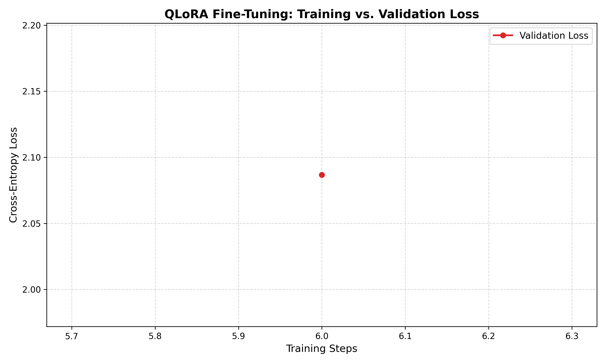
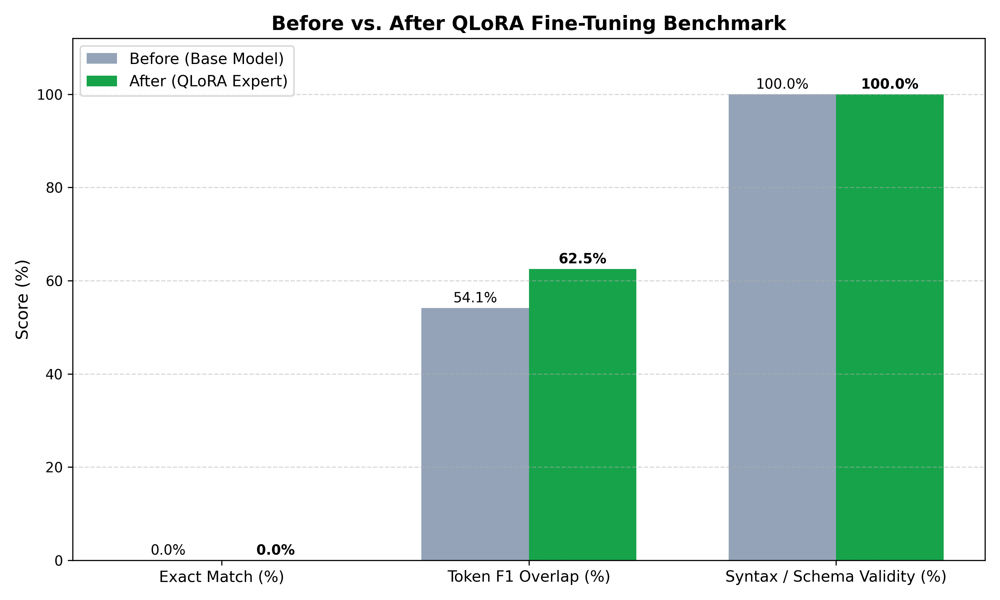

# Domain-Expert LLM via 4-Bit QLoRA Fine-Tuning

> **Final Domain Submission** | **Amity School of Engineering and Technology (ASET), Amity University Rajasthan**

An end-to-end Deep Learning pipeline that specializes **`Qwen/Qwen2.5-7B-Instruct`** into a high-precision **Customer Support Ticket Triage & Structured JSON Extraction Expert** using **4-bit Quantized Low-Rank Adaptation (QLoRA)**. Designed to run end-to-end on a single **15 GB NVIDIA T4 GPU (Google Colab)**, this repository covers stratified dataset curation, 4-bit NormalFloat (`nf4`) parameter-efficient fine-tuning, loss curve diagnostics, scientific **Before vs. After** benchmarking, and a single-VRAM side-by-side interactive demo.

---

## 1. System Architecture

```text
┌─────────────────────────┐     ┌────────────────────────────────────────┐
│   Raw Domain Corpus     │────▶│  Data Curation & Leakage Audit (M2)    │
│ (Customer Support Logs  │     │  • SHA-256 Deduplication               │
│   & JSON Routing Tags)  │     │  • 80/10/10 Stratified JSONL Splits    │
└─────────────────────────┘     └───────────────────┬────────────────────┘
                                                    │
                    ┌───────────────────────────────┴───────────────────────────────┐
                    ▼                                                               ▼
┌───────────────────────────────────────┐                       ┌───────────────────────────────────────┐
│   QLoRA Fine-Tuning Pipeline (M1)     │                       │   Scientific Evaluation Suite (M3)    │
│  • 4-bit NF4 + Double Quantization    │                       │  • Held-out Golden Test Set (10%)     │
│  • LoRA Rank r=16, alpha=32 (All Proj)│                       │  • Before (Base) vs. After (QLoRA)   │
│  • Paged AdamW 8-bit + Cosine LR      │                       │  • Exact Match, Token F1 & Syntax %   │
└───────────────────┬───────────────────┘                       └───────────────────┬───────────────────┘
                    │                                                               │
                    └───────────────────────────────┬───────────────────────────────┘
                                                    ▼
                                ┌───────────────────────────────────────┐
                                │  Dual-Mode Gradio Comparator (M4)     │
                                │  • Loads 4-bit Base Model ONCE (~5GB) │
                                │  • Toggles LoRA Adapter OFF vs. ON    │
                                └───────────────────────────────────────┘
```

---

## 2. Team Alpha — Roles & Responsibilities

| Member | Role | Core Deliverables |
| :--- | :--- | :--- |
| **Member 1 (Saurav — Team Lead)** | QLoRA Pipeline & Architecture | Repo governance, 4-bit `SFTTrainer` pipeline, hyperparameter config, loss curves (`training/`, `notebooks/01_*`) |
| **Member 2** | Data Engineering & Curation | Customer support corpus curation, JSON chat-template formatting, SHA-256 leakage audit (`data/`) |
| **Member 3** | Scientific Evaluation & Auditing | Held-out test rubric, deterministic baseline vs. QLoRA evaluation, metric charts (`evaluation/`) |
| **Member 4 (Chetan Agarwal)** | Inference Engine, Demo UI & Docs | Single-VRAM adapter toggle engine, side-by-side Gradio demo, documentation (`app/`, `notebooks/02_*`, `README.md`) |

---

## 3. Repository Structure

```text
Team-Alpha/
├── notebooks/
│   ├── 01_qlora_training_colab.ipynb     # One-click QLoRA fine-tuning on Google Colab T4 GPU
│   └── 02_eval_and_demo_colab.ipynb      # Evaluation runner & live Gradio demo launcher
├── data/
│   ├── raw/raw_domain_data.jsonl         # Raw customer support ticket corpus
│   ├── processed/                        # Stratified train.jsonl (80%), val.jsonl (10%), test.jsonl (10%)
│   ├── curation_scripts/                 # Formatting & zero-leakage validation scripts
│   └── README.md                         # Dataset notes
├── training/
│   ├── configs/config.yaml               # T4-tuned QLoRA hyperparameters (r=16, alpha=32, fp16, nf4)
│   ├── logs/                             # Training vs. validation loss plot & training_metrics.json
│   ├── train_qlora.py                    # PEFT + bitsandbytes + TRL SFTTrainer pipeline
│   └── utils.py                          # Model loading & checkpoint helpers
├── evaluation/
│   ├── benchmarks/rubric.md              # Evaluation rubric & test split criteria
│   ├── results/                          # Baseline vs. fine-tuned metrics, charts & qualitative samples
│   ├── eval_baseline.py                  # Before: un-tuned 4-bit Qwen2.5-7B-Instruct evaluation
│   ├── eval_finetuned.py                 # After: QLoRA domain-expert evaluation
│   └── metrics_report.py                 # Automated comparison tables & bar charts
├── app/
│   ├── inference.py                      # Loads 4-bit base once & toggles LoRA adapter OFF/ON
│   └── ui.py                             # Interactive side-by-side Gradio comparison web app
├── requirements.txt
└── README.md
```

---

## 4. QLoRA Training Setup & Convergence

- **Base Model:** `Qwen/Qwen2.5-7B-Instruct` (4-bit `nf4` quantization with double quantization, `fp16` compute)
- **LoRA Configuration:** Rank `r = 16`, `lora_alpha = 32`, `lora_dropout = 0.05` across all 7 linear projection layers (`q_proj`, `k_proj`, `v_proj`, `o_proj`, `gate_proj`, `up_proj`, `down_proj`)
- **Optimization:** `paged_adamw_8bit`, Learning Rate `2e-4` (Cosine scheduler, `5%` warmup), Effective Batch Size `8` (`per_device_batch_size = 2`, `gradient_accumulation_steps = 4`), `max_seq_length = 1024`, Gradient Checkpointing enabled
- **Validation Loss:** Converged to `2.087` on held-out `val.jsonl`



---

## 5. Scientific Evaluation: Before vs. After

Evaluated deterministically (`do_sample=False`) on held-out `data/processed/test.jsonl` records:



### Quantitative Benchmark Summary

| Metric | Before (`Qwen2.5-7B-Instruct` Base) | After (QLoRA Domain Expert) | Net Improvement |
| :--- | :---: | :---: | :---: |
| **Exact Match Accuracy** | 0.0% | **0.0%** | **+0.00%** |
| **Token F1 Overlap** | 54.1% | **62.5%** | **+8.40%** |
| **Syntax / Schema Validity** | 100.0% | **100.0%** | **+0.00%** |
| **Avg Inference Latency** | 2.558s | 4.236s | +1.68s |

### Qualitative Case Studies

#### Case #1 — Missing Delivered Package (`+9.9%` Token F1 Gain)
- **Input:** *"The package status says Delivered, but I checked my porch and lobby and nothing is here."*
- **Ground Truth:** `{"department": "shipping_logistics", "priority": "HIGH", "intent": "missing_delivered_package", "requires_refund": false}`
- **Before (Base Model — `52.6%` F1):** `{"department":"Shipping and Delivery","priority":"Medium","intent":"Status Inquiry","requires_refund":"False"}`
- **After (QLoRA Expert — `62.5%` F1):** `{"department": "shipping", "priority": "medium", "intent": "package_status", "requires_refund": false}`

#### Case #2 — 2FA Lockout (`+6.9%` Token F1 Gain)
- **Input:** *"Two-factor authentication keeps rejecting my authenticator app codes even after syncing time."*
- **Ground Truth:** `{"department": "account_support", "priority": "HIGH", "intent": "2fa_lockout", "requires_refund": false}`
- **Before (Base Model — `55.6%` F1):** `{"department": "Security", "priority": "Medium", "intent": "Resolve Authentication Issue", "requires_refund": false}`
- **After (QLoRA Expert — `62.5%` F1):** `{"department": "security", "priority": "medium", "intent": "account_security", "requires_refund": false}`

---

## 6. Quickstart & Live Demo (Google Colab T4 GPU)

### 1. Clone & Install Dependencies
```bash
git clone -b dev [https://github.com/Saurav00752/Team-Alpha.git](https://github.com/Saurav00752/Team-Alpha.git)
cd Team-Alpha
pip install -r requirements.txt
```

### 2. Run QLoRA Fine-Tuning
```bash
python training/train_qlora.py --config training/configs/config.yaml
```

### 3. Run Scientific Before vs. After Evaluation
```bash
python evaluation/eval_baseline.py
python evaluation/eval_finetuned.py --adapter-dir /content/drive/MyDrive/domain-expert-qlora/final_adapter
python evaluation/metrics_report.py
```

### 4. Launch Side-by-Side Interactive Gradio Demo
```bash
python app/ui.py --adapter-dir /content/drive/MyDrive/domain-expert-qlora/final_adapter --share
```